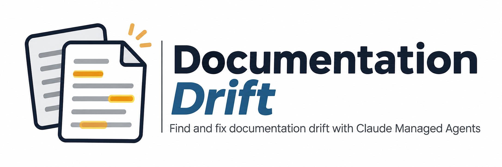

<picture>
  
</picture>

---

# From Calling Claude to Operating an Agent

A 60-minute hands-on lab for Claude Managed Agents.

You've called Claude: send a request, read a response. In this lab you **operate** an agent instead. You start a Documentation Drift Agent that runs on Anthropic's side, in a sandbox, and you watch it, steer it, collect its work, and clean up after it.

| Calling Claude | Operating an agent | Lab step |
|---|---|---|
| A request and a response | A session with a lifecycle: create, run, idle, resume, delete | 2, 6 |
| You write the loop | The loop runs on Anthropic's side; you watch it through events | 3 |
| Stateless; you resend the history | State lives on the server: history, sandbox files, outputs | 4, 5 |
| You read the response | You stream events, steer, or interrupt mid-run | 3, 4 |
| Your code runs the tools | You decide which tools it may use, and it runs them in a sandbox | 1 |
| Cost is per call | Cost and time are per session, so cleanup matters | 2, 6 |

**The task.** `fixture/` holds `metrolen`, a tiny fictional unit-conversion library at version 2, plus documentation written for version 1. The agent runs every code sample in the docs inside its sandbox, finds the ones that no longer match the code, and writes a drift report.

## What you'll be able to do

1. Configure an agent and its sandbox with only the tools and network access a task needs.
2. Start a session that loads local files into the sandbox under a spend cap, and say what each saved ID refers to.
3. Follow an autonomous run through its event stream, detach and reattach without affecting it, and point to the event that shows the agent ran a sample and the error it got.
4. Send the same session more work from the command terminal, and explain when a message sent mid-run takes effect.
5. Download the agent's outputs and check its work against a structured contract instead of reading its prose.
6. Clean up a session safely, keeping a local copy first, and say what remains afterward.

## Before you start

- Python 3.12 or newer, and [uv](https://docs.astral.sh/uv/).
- An Anthropic API key with access to Managed Agents (beta).
- **Two terminals, both open in this folder:** the **watch terminal** shows the agent's events (from step 3 on), and the **command terminal** runs everything else.
- Each step's script has one function for you to fill in. Until you do, the script stops with a `YOUR TURN (step N): ...` message instead of running. That's expected. `watch.py`, `check.py`, and `replay.py` are complete, and `solution/` has reference versions if you get stuck.
- Cost: one full run on the default model (`claude-haiku-5-5`) cost about **$0.01** in testing. That figure is the session's own usage report (`usage.list_cost`): tokens and running time priced at public list rates, rounded to the nearest cent. Your bill can be lower if your organization has negotiated pricing. Step 6 prints your session's figure before deleting it. Every session is capped at **$0.50**.

## Setup (5 minutes)

Open both terminals now, each in this folder. Pick one as your **watch terminal** and the other as your **command terminal**. Setup runs in the command terminal.

PowerShell (Windows):

```powershell
# command terminal
uv sync
Copy-Item .env.example .env
notepad .env            # paste your key after ANTHROPIC_API_KEY=
uv run check.py 0
```

macOS or Linux:

```bash
# command terminal
uv sync
cp .env.example .env    # then edit .env and paste your key
uv run check.py 0
```

Expected:

```text
PASS: API key found (not shown), anthropic 2.5.0, Managed Agents API reachable
```

`uv run check.py summary` shows your progress at any time.

---

## Step 1: Define the agent and its sandbox (10 minutes, work it out)

Open `01_define.py` and read the task card at the top. The agent has to run Python files, read files, and write two reports. It needs nothing from the internet and must not install anything.

Fill in `choose_permissions()`. It returns two things:

- **`tools`**: the agent's tool list, built from the `agent_toolset_20260401` toolset. See [Tools](https://platform.claude.com/docs/en/managed-agents/tools) for the built-in tools and how to turn each one on or off.
- **`networking`**: the sandbox's network access. See [Environments](https://platform.claude.com/docs/en/managed-agents/environments#networking).

**Start with the defaults to see what they allow.** Return `[{"type": "agent_toolset_20260401"}]` and `{"type": "unrestricted"}`, then run, in the command terminal:

```powershell
# command terminal
uv run 01_define.py
uv run check.py 1       # EXPECTED TO FAIL with the defaults
```

The check explains what's wrong and why. Change your choices and run both commands again. The second run **updates** the same agent and gives it a new version number; it doesn't create a second agent.

```text
Updated agent agent_01...: version 1 -> 2
Updated environment env_01... (applies to new sessions)
...
PASS: agent version 2 can run code, has no web tools, and its sandbox has no egress
```

**Reflect (not graded):** for each tool you left on, could the agent do the task without it?

## Step 2: Start a session (5 minutes)

Fill in `create_session()` in `02_start.py`. The call looks like this:

```python
return client.beta.sessions.create(
    agent=agent_id,
    environment_id=environment_id,
    resources=resources,
    title="metrolen documentation drift check",
    budget={"type": "limit", "max_list_cost": {"amount": BUDGET_CENTS, "currency": "USD"}},
)
```

The script uploads the fixture, creates the session, saves its ID to `.lab-state.json`, and sends the drift task. Run it in the command terminal:

```powershell
# command terminal
uv run 02_start.py
uv run check.py 2
```

```text
Uploaded 7 files
Created session sesn_01... (agent version 2, budget $0.50, status idle)
Sent the drift task. The agent is working now, on Anthropic's side.
...
PASS: session sesn_01... is running, with 7 files mounted and a $0.50 cap
```

The IDs in `.lab-state.json` are your only handles on things that exist on Anthropic's servers. A running session costs money whether or not you're watching it.

## Step 3: Watch it work (8 minutes, watch terminal)

```powershell
# watch terminal
uv run watch.py
```

The watcher first prints what already happened (`earlier`), then streams new events (`live`). Look for a `tool: bash` line running a sample and a `result: ERROR ...` line after it: that's the agent running code and getting an error back.

Now press **Ctrl+C**. On Windows it can take a few seconds to detach. Then run `uv run watch.py` again.

```text
Detached. The session keeps running on Anthropic's side. Reattach: uv run watch.py
Attached to sesn_01.... Catching up on 56 earlier events:
earlier 16:47:43  tool:    bash: cd /tmp && PYTHONPATH=/mnt/session/uploads/fixture python3 sample_parsing_22.py ...
earlier 16:47:44  result:  ERROR TypeError: parse_quantity() got an unexpected keyword argument 'strict'
...
```

Your lines will differ: the agent decides how to run the samples, and sometimes batches several into one script.

The agent is fast. **It often finishes in under a minute, sometimes before you reattach.** That's fine: reattaching to a finished session still shows everything it did while you weren't watching, because the history lives on the server.

```powershell
# command terminal
uv run check.py 3
```

```text
PASS: watched 2 times; the agent made 8 bash calls
INFO: tool calls the agent made while no watcher was attached: 8
INFO: first error a doc sample produced: TypeError: parse_quantity() got an unexpected keyword argument 'strict'
```

## Step 4: Send it more work (8 minutes, command terminal)

Fill in `send_message()` in `steer.py`:

```python
client.beta.sessions.events.send(session_id, events=[
    {"type": "user.message", "content": [{"type": "text", "text": text}]},
])
```

Then, in the command terminal:

```powershell
# command terminal
uv run steer.py
```

With no arguments, it asks the agent to write corrected copies of the drifted doc pages and run their samples. Watch it in the watch terminal (`uv run watch.py`), then:

```powershell
# command terminal
uv run check.py 4
```

```text
PASS: the same session handled 2 messages without starting over
INFO: your first follow-up arrived after the first run finished, so it started a new turn
```

**When does a message take effect?** If the agent is still running, your message waits until its current step finishes, then the agent takes it into account. If the agent has finished, your message starts a new turn in the same session, with the same sandbox, files, and conversation. The check tells you which happened. Both pass.

**Optional drill: interrupt.** Ask for something long, then stop it:

```powershell
# command terminal
uv run steer.py "Re-run every doc sample 5 more times, one bash call per run."
uv run steer.py --interrupt
```

The session goes idle within about a second, and stays usable.

## Step 5: Collect and check the agent's work (7 minutes)

Fill in `download_outputs()` in `03_collect.py`:

```python
saved = []
for file in client.beta.files.list(scope_id=session_id, betas=[MANAGED_AGENTS_BETA]):
    if not file.downloadable:      # your own uploads are listed too
        continue
    path = destination / file.filename
    client.files.download(file.id).write_to_file(path)
    saved.append(path)
return saved
```

```powershell
# command terminal
uv run 03_collect.py
uv run check.py 5
```

```text
PASS: both reports downloaded; drift-report.json matches the contract
AGENT: coverage: reported 7 of 7 doc samples
AGENT: drifts found: 3 of 3, kind correct for 3
AGENT: decoy: correctly reported as matching the docs
AGENT: false positives: 0
AGENT: evidence reproduced locally: 7 of 7
...
```

Two kinds of result:

- **`PASS` / `NOT YET`** is about you: did you get valid reports out of the sandbox?
- **`AGENT:`** is about the agent. The fixture has three planted drifts and one **decoy**: a sample that looks outdated but still works. `check.py` compares the report with what it gets by running the trusted fixture samples on your machine. It never runs anything the agent wrote.

If the agent missed a drift or flagged the decoy, you still pass this step. That miss is the point: it's why the report has a schema and why you check it rather than trusting it.

## Step 6: Clean up (5 minutes)

Fill in `delete_session()` in `04_cleanup.py`:

```python
client.beta.sessions.delete(session_id)
```

```powershell
# command terminal
uv run 04_cleanup.py
uv run check.py 6
uv run check.py summary
```

```text
Recorded 96 events to recordings\sesn_01....jsonl
Session cost: $0.01 at list prices (rounded to the nearest cent), against a $0.50 budget
  tokens: 36 input, 11,143 output, 21,347 cache write, 214,672 cache read; running time: 68 s
Deleted session sesn_01... (it now returns 404)
Deleted 7 uploaded files
Kept agent agent_01... and environment env_01... for next time.
PASS: session deleted (404), uploads deleted, recording kept at sesn_01....jsonl
```

The cost line comes from the session's own usage report (`usage.list_cost`), read just before the delete: tokens and running time at public list rates, rounded to the nearest cent. Deleting is permanent, so the script also records the session's events to `recordings/` first. Replay them any time with `uv run replay.py recordings/<file>.jsonl`.

The agent and environment are kept so you can run the lab again. When you're done for good: `uv run 04_cleanup.py --all`. That deletes the environment and **archives** the agent: agents can't be deleted, and archiving is permanent.

## Stretch: check the fixes

After step 4, the agent wrote `fixed-quickstart.md`, `fixed-formatting.md`, and `fixed-parsing.md`, and step 5 downloaded them to `outputs/`.

```powershell
# command terminal
uv run check.py stretch
```

This reads the fixed pages and confirms the drifts are gone. It doesn't run them on your machine: the agent already ran them in its sandbox, which is where code you didn't write belongs. Review `outputs/fixed-*.md` against `fixture/docs/` yourself. Would you merge them?

---

## Troubleshooting

| You see | What it means | What to do |
|---|---|---|
| `No ANTHROPIC_API_KEY found` | `.env` is missing or empty | `Copy-Item .env.example .env` and add your key |
| `API error 400: The request was invalid` | A malformed ID, often a copy-paste typo | Check the IDs in `.lab-state.json` |
| `NOT YET: the saved session no longer exists` | The session was deleted | `uv run 02_start.py --new` |
| `Cannot delete session while it is running` | Only idle sessions can be deleted | `uv run 04_cleanup.py` interrupts first; run it again |
| `The session reached its spend cap and paused` | The $0.50 budget was used up | Clean up and start a new session; or set `LAB_BUDGET_CENTS` higher in `.env` |
| `uv run watch.py` prints history and exits | The session is idle with nothing queued | Expected. Send more work with `uv run steer.py` |
| Ctrl+C takes a few seconds | Windows delivers it when the stream next receives data | Wait; it detaches |
| No output files in step 5 | The agent hadn't finished, or files were still indexing | Wait for idle in the watch terminal, then collect again |
| The agent says the sandbox has Python 3.11 | The sandbox's default `python3` is 3.11 | Expected. The fixture supports Python 3.10 and newer |
| The agent tries `pip install` and fails | Your sandbox has no internet access | Expected: that's the least privilege you chose in step 1 |
| Console link says "Session not found" | Your key isn't in the Default workspace | Set `LAB_WORKSPACE` in `.env` to your workspace ID |

## For instructors

- **Demo fallback:** `uv run replay.py recordings/demo.jsonl --speed 2` replays a known-good recorded run: 3 of 3 drifts, decoy passed, a follow-up turn. No API key or network needed.
- **Reference solution:** `solution/` holds complete versions of the five learner scripts. Run them with `uv run solution/02_start.py` and so on. `uv run solution/make_stubs.py` regenerates the learner files from them.
- **Tests:** `uv run pytest` runs offline tests of the fixture, schema, checks, and stubs. They make no API calls.

---

This is an independent educational project, not official Anthropic documentation. For the platform itself, see the [Managed Agents docs](https://platform.claude.com/docs/en/managed-agents/overview). Licensed under the [MIT License](LICENSE); see also [SECURITY.md](SECURITY.md), [CONTRIBUTING.md](CONTRIBUTING.md), and [SUPPORT.md](SUPPORT.md).
