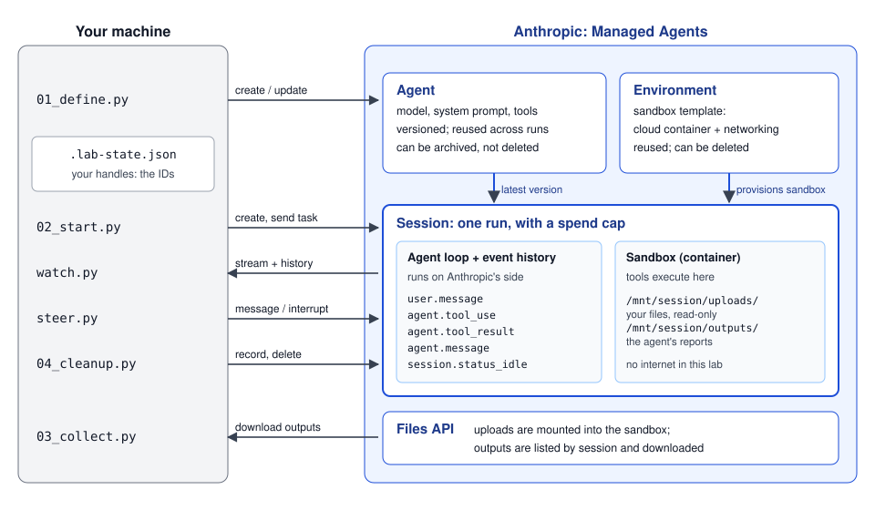
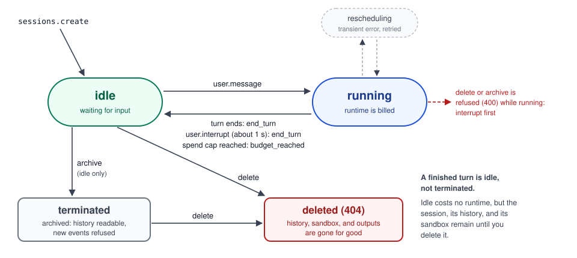
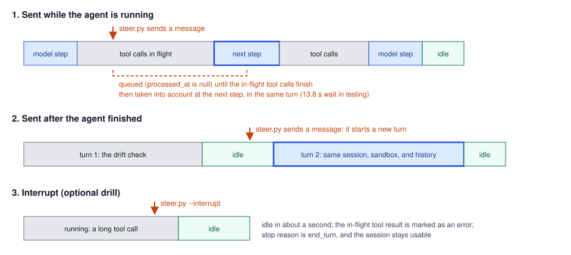

# From calling Claude to operating an agent

**Claude Managed Agents, through a Documentation Drift Agent**

20 minutes of concepts and a live demo, then a 60-minute hands-on lab

---

## Three ways to put Claude to work

| | Messages API | Agent SDK | Managed Agents |
|---|---|---|---|
| Who runs the loop | You | The SDK, in your process | Anthropic |
| Where tools run | Your code | Your machine or servers | A sandbox per session, hosted by Anthropic |
| Where state lives | You resend the history | Your process | On the server: history, sandbox files, outputs |
| What you hold | A response | A running program | A **session ID** |

**The test:** must an agent *do* things somewhere, for a while, without you hosting it?

**When not to use it:** low-latency single calls, when you need control of every step of the loop, or when ZDR or HIPAA coverage is required.

Our example: check whether a library's docs still match its code by **running** every sample.

---

## The resource model



---

## Least privilege: decide what it can touch

- The defaults are permissive: the toolset includes web search and web fetch, and an environment created through the API has **unrestricted** networking.
- The drift task needs to run code and read and write files. It needs nothing from the internet.
- So the lab's agent gets **no web tools** and **no network access out of the sandbox**.
- In testing, the agent tried `pip install jsonschema`. With no egress, the install failed and it checked the schema by hand instead.

Step 1 of the lab is the one you work out yourself.

---

## Start the session, then watch it



The agent loop runs on Anthropic's side. Your watcher is only a view of it.

---

## Detach, reattach, recover

- Closing the watcher (Ctrl+C) **does not stop, pause, or interrupt** the session.
- The stream has **no replay**. To reattach: open the stream, list the history, skip events you've seen.

```python
with client.beta.sessions.events.stream(session_id) as stream:
    seen = {event.id for event in client.beta.sessions.events.list(session_id)}
    for event in stream:
        if event.id not in seen: ...
```

- An idle session sends no new events: check its status before you wait on the stream.
- The drift run often finishes in **under a minute**. Reattaching afterward still shows everything it did.

---

## Send more work to the same session



A message is not an interrupt. Either way, it's the **same session**.

---

## Claims versus evidence

| The agent's report (claims) | `check.py` (verification) |
|---|---|
| `drift-report.json`: one result per sample, with the command, exit status, stdout, stderr, and kind | **PASS / NOT YET:** did *you* operate the platform correctly? |
| Schema-valid means well-formed, **not true** | **AGENT:** compares the report with ground truth from running the trusted fixture samples locally |
| Written by the agent inside the sandbox | Never runs anything from the report |

Outputs come back through the Files API, listed by session (skip `downloadable: false`: your own uploads). In testing: 3 of 3 drifts and the decoy passed, in **two runs**. Evidence, not a guarantee.

---

## Done running is not done

- A finished run is **idle**: no runtime charge, but its history, sandbox, and outputs remain until you delete it.
- Every lab session has a **spend cap** ($0.50). At the cap it pauses (`budget_reached`) and refuses new messages. The last request can overshoot it slightly.
- **Operationally finished** means: outputs downloaded, a local recording saved, the session deleted (404), uploads deleted.
- Delete is permanent, and a running session must be interrupted first.
- Agents can be archived but not deleted, so reuse them.

One lab run on `claude-haiku-5-5` cost about **$0.01** in testing.

---

## Your turn: the lab (60 minutes)

| Step | You do | Platform checkpoint |
|---|---|---|
| 0 Setup | `uv sync`, add your key | API reachable |
| 1 Define (**work it out**) | Choose tools and network access | bash on, web off, no egress |
| 2 Start | Create the session with a budget | Files mounted, cap set |
| 3 Watch | Ctrl+C, then reopen | Watched twice, saw a sample error |
| 4 Continue | `steer.py` | Second message handled, same session |
| 5 Collect | Download the reports | Schema-valid; `AGENT:` lines are information only |
| 6 Clean up | Delete the session | Session 404, recording kept |
| Stretch (optional) | `check.py stretch` | Fixed docs checked by reading, not running |

Two terminals, both in the repository folder. A `YOUR TURN` stop is expected until you fill in that step's function.
